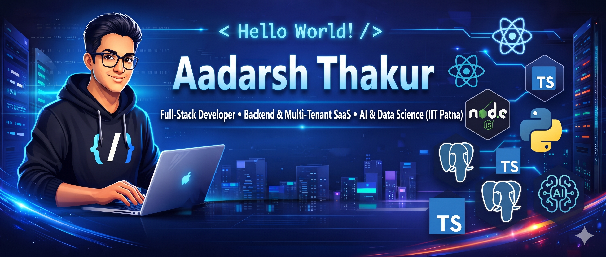

  

# < Hello World 👋, I'm **Aadarsh Thakur** />

### **Full-Stack Developer • Backend & Multi-Tenant SaaS • AI & Data Science (M.Tech @ IIT Patna)**

---

# 👨‍💻 About Me

Full-stack and backend-focused developer building **multi-tenant SaaS platforms, data-backed applications, and AI-integrated workflows**. Currently pursuing **M.Tech in Artificial Intelligence & Data Science at IIT Patna**.

* Designing **multi-tenant systems** with PostgreSQL Row-Level Security (RLS), role-based access, and scalable REST APIs
* Building **real-time workflows, payment/messaging integrations, and automated ETL pipelines**
* Optimizing database schemas, queries, and full-stack performance

---

# 🛠 Tech Stack

* **Languages:** JavaScript • TypeScript • Python • SQL
* **Frontend:** React.js • Next.js • TanStack Start & Query • Tailwind CSS • Shadcn UI • Vite • Framer Motion
* **Backend & Realtime:** Node.js • Express.js • Flask • REST APIs • WebSockets (Flask-SocketIO) • Firebase Cloud Functions
* **Databases & Auth:** PostgreSQL • Supabase (RLS, Migrations, Realtime) • Firebase Firestore • MongoDB • SQLite • OAuth 2.0 / JWT
* **AI & Integrations:** Google Gemini • OpenAI • Groq (Llama 3.x) • Razorpay • Stripe • Twilio WhatsApp • Resend
* **Tools & Cloud:** Git • GitHub • GitHub Actions • Firebase Hosting • Postman • Vitest

---

# 🚀 Featured Projects & Repositories

### 💼 Escrow Suite (Escrow Bill, Account Ledger & Payroll)
* Multi-tenant billing/POS, ledger, and business management systems built with **React, TypeScript, and Supabase PostgreSQL**.
* Implemented **PostgreSQL RLS policies, role-based access, stored procedures, and SQL migrations** for tenant-isolated data, alongside real-time order sync and payment/messaging integrations.

### 📊 MFAnalytics — Macro Data Pipeline
* Automated **ETL pipeline** using **GitHub Actions, Node.js, and Python** to normalize macroeconomic feeds into structured time-series data.
* Paired with a frontend dashboard and **PostgreSQL (RLS)** schema for analytical workflows.

### 🤖 AI & Domain Applications (`hyphomz-ai-platform`, `Medcore-HMS`, `Smart-City-System`)
* Built full-stack and ML/AI-integrated applications including home services with Next.js & ML integration, healthcare management (`Medcore-HMS`), and automation/messaging tools.

### 🔵 Taliwo — AI Career Platform
* Built an AI-powered career platform with **React, Firebase Functions, and multi-model AI fallbacks (Gemini / Groq / OpenAI)**.
* Included resume/ATS scoring, scheduled job crawling, and **Razorpay** checkout.

---

# 💼 Experience

### 🚀 Full Stack Developer — Ash-Tech Solutions
**Jan 2026 – Oct 2026**

* Built and maintained multi-tenant business applications (billing/POS, ledger, ERP, inventory, cashbook, payroll) using React, TypeScript, Supabase PostgreSQL, and Firebase Hosting.
* Designed PostgreSQL schemas with Row-Level Security, role-based access, and incremental SQL migrations.
* Integrated Razorpay, Stripe, Twilio WhatsApp, Resend, and UPI QR workflows, plus real-time sync and bug fixes.

### ⚙️ Backend Developer Intern — Ash-Tech Solutions
**Jul 2025 – Jan 2026**

* Built backend services and REST APIs using Node.js & Express.js with validation and error handling.
* Developed serverless workflows with Firebase Cloud Functions and integrated Supabase PostgreSQL.

---

# 🎓 Education & Highlights

* **M.Tech, Artificial Intelligence & Data Science** — Indian Institute of Technology Patna *(2026 – 2028)*
* **B.Tech, Computer Science Engineering** — G.L. Bajaj Group of Institutions *(2021 – 2025)*
* Published two patents (2024): *GPS-Based Luggage Security System* & *Agricultural Management Device* • 4th place, *ITS Codeathon*

---

# 📡 Connect With Me

* **Portfolio:** https://aadarsh-portfolio-49ac6.web.app/
* **Email:** [thakuraadarsh1@gmail.com](mailto:thakuraadarsh1@gmail.com)
* **LinkedIn:** https://www.linkedin.com/in/aadarsh-thakur-1bbb29230

---

⭐ If you like my work, consider giving a star to my repositories.
